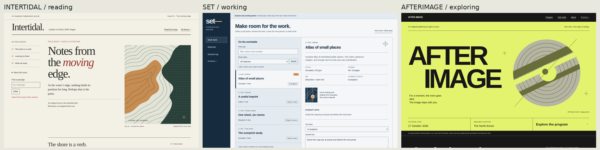

# Hardlight UI

**Frontend design, shaped by imagination.**

A native [Hermes Agent](https://github.com/NousResearch/hermes-agent) plugin for distinctive websites and apps that people can find their way through. Hardlight pairs artistic direction with working inspection, contrast and navigation tools. It is not a component library, a template reskinner or a second model service.

[Explore the examples](examples/index.html) · [Research and sources](docs/research.md) · [Contribute](CONTRIBUTING.md)



## Design a point of view. Keep the path clear.

Most frontend guidance stops at a list of aesthetic rules. Hardlight adds inspectable structure:

| Tool | What it returns |
| --- | --- |
| `hardlight_reference` | Task-sized craft references and an original artistic atlas, loaded on demand |
| `hardlight_direction` | A brief-preserving direction packet: structural alternatives, constraints, navigation questions, state coverage and a verification plan |
| `hardlight_inspect` | Bounded, read-only frontend findings and existing CSS tokens with file/line evidence |
| `hardlight_contrast` | Deterministic WCAG contrast calculations for explicit text, large-text and UI pairs |
| `hardlight_navigation` | Reachability, task paths, missing destinations, ambiguous link labels, dead ends and explicit path-budget overruns |

The bundled `hardlight-ui:frontend-design` skill makes these tools part of a complete design workflow. `/hardlight` shows help, styles and version. An optional local Chrome/Playwright runner captures responsive screenshots and computed DOM findings without a hosted service.

The installed runtime uses Python's standard library. No API key, extra model subscription, telemetry, hidden inference or background service is required. Browser development has an explicit optional dependency.

## Artistic breadth without a house-style trap

The atlas spans Swiss editorial structure, Bauhaus-derived geometry, expressive typography, contemporary editorial, neo-brutalism, organic craft, cinematic storytelling, quiet restraint, Deco geometry, retro-futurism, productive workbenches, analytical displays, wayfinding, illustration, spatial/technical work and expressive material design.

These are **compositional grammars**, not color presets. Each connects layout, type, material, imagery, motion, interaction, mobile behavior and failure conditions. Select the task structure first, then a dominant grammar. A brand, platform convention or established design system takes precedence over a new style suggestion.

Research draws on actual websites, current curated galleries, design history, primary design-system guidance and W3C interaction/accessibility standards. Sources distinguish visual inspiration from usability evidence. An award does not prove task success, and an attractive screenshot does not prove a working interface.

## The no-slop standard

A design needs a product-specific idea that changes visible decisions. For an open direction, compare materially different structures rather than three accent colors.

- Let the actual product, content, original artwork or meaningful interaction carry the identity.
- Make navigation labels, location, primary task and recovery paths explicit.
- Build controls and real states, not decorative buttons or imaginary dashboards.
- Use real claims or clearly labeled illustrative content. Never invent customers, testimonials, metrics or benchmarks.
- Inspect the rendered result at wide and narrow sizes, with keyboard use and reduced motion. Fix observed failures.

Hardlight does not assign a numerical beauty or “AI-slop” score. Tools can expose concrete defects; artistic distinction and task clarity still require thoughtful design and rendered review. There is no blanket ban on cards, gradients, glass, serif, monospace, minimalism or maximalism. Ban failures, not styles.

## Install into Hermes

Requires a Hermes build supporting native tool, command and bundled-skill registration. The plugin checks required registration methods and reports an actionable compatibility error rather than patching Hermes internals. The optional stable discovery pointer uses the documented new-session prompt-section API when present.

Review the source before enabling any native plugin. Repository shorthand is a direct source install, not a claim of admission to the official Hermes catalog.

```sh
hermes plugins install nosliwhtes/hardlight-ui --no-enable
hermes plugins enable hardlight-ui
```

For a reproducible install, add `--ref` followed by the full 40-character commit SHA you reviewed. Use a new session or your Hermes version's supported plugin reload path. Enabling on disk does not prove an already-running conversation loaded it; do not restart active work blindly.

Nothing in the installer removes Impeccable or edits another skill. If migrating, update your own project/agent instructions to use `hardlight-ui:frontend-design`, verify a real design task, then separately decide whether to archive the old skill.

## Use it

Ask Hermes:

> Use Hardlight UI to design a cultural journal. Compare an asymmetric editorial direction with a typographic poster direction and an illustrated field-guide direction. Keep reading and section navigation obvious on mobile.

> Audit this existing app without rebranding it. Start with the three most important user tasks, inspect the current tokens, and identify broken navigation, inaccessible states and visual inconsistencies.

> Show whether users can reach the invoice export from the home screen. Report ambiguous labels, missing destinations and the exact task path. Do not assume fewer clicks always means better navigation.

For direct use from a source checkout:

```sh
python -m hardlight --help
python -m hardlight styles
```

The CLI shares the plugin's pure functions. Subcommand help documents direction, reference, inspection, contrast, graph input and optional browser arguments. Errors are explicit JSON with nonzero exits. No command automatically publishes a project or installs a browser.

### Navigation input

`hardlight_navigation` accepts an explicit page graph and user tasks. For example:

```json
{
  "home": "home",
  "pages": [
    {"id": "home", "label": "Home", "links": [{"to": "reports", "label": "Reports"}]},
    {"id": "reports", "label": "Reports", "links": [{"to": "export", "label": "Export invoices"}]},
    {"id": "export", "label": "Export invoices", "links": [{"to": "reports", "label": "Back to reports"}]}
  ],
  "tasks": [{"name": "Export invoices", "start": "home", "goal": "export", "max_steps": 2}]
}
```

The path is a graph result, not a user-study result. Supply a budget when it serves the task; Hardlight does not impose a universal three-click rule. Cycles are valid, and explicit task goals are distinguished from accidental dead ends.

## Working examples

The offline examples are authored demonstrations, not before/after benchmarks:

- [Editorial](examples/editorial.html): reading, indexing and content hierarchy.
- [Workspace](examples/workspace.html): repeated tasks, selection and working state.
- [Expressive](examples/expressive.html): an art-directed cultural surface with explicit wayfinding.

Open `examples/index.html` in a browser. The pages use original local HTML/CSS/SVG and vanilla JavaScript, without external fonts, frameworks or network assets. Illustrative content is labeled.

## Verification and limits

Bounded source inspection requires POSIX no-follow, directory-relative file APIs. On unsupported platforms, including Windows, `hardlight_inspect` returns an explicit compatibility error rather than scanning unsafely; the reference, direction, contrast and navigation tools remain available.

Static source inspection is heuristic, especially for JSX/TSX and framework-generated semantics. File, byte and traversal limits are explicit; skipped coverage is not a clean pass. Contrast supports explicit opaque hexadecimal colors; gradients, transparency, imagery and unresolved colors need further inspection.

The optional browser runner accepts explicit local HTML or literal-loopback HTTP targets and blocks external network access. Reports and screenshots stay in the chosen output directory. Treat them as potentially private project evidence. Automated DOM checks do not establish full WCAG conformance, screen-reader usability, field performance or artistic quality. Review keyboard behavior, important states and real task completion separately.

The initial release establishes working capabilities, not an empirical claim that one plugin or model always produces better art than another. [Observed checks and limits](docs/verification.md) describe the local evidence; [the release contract](docs/plans/initial-release/design.md) makes the requirements and exclusions inspectable.

## Community

Contributions can improve artistic grammars, navigation analysis, accessibility rules, browser evidence and examples. Start with [CONTRIBUTING.md](CONTRIBUTING.md), include a concrete user task and a reproducible check, and open a pull request. CI runs for contributions; maintainers decide what ships. There is no automatic merge or live-profile mutation.

[Security policy](SECURITY.md) · [MIT license](LICENSE)
