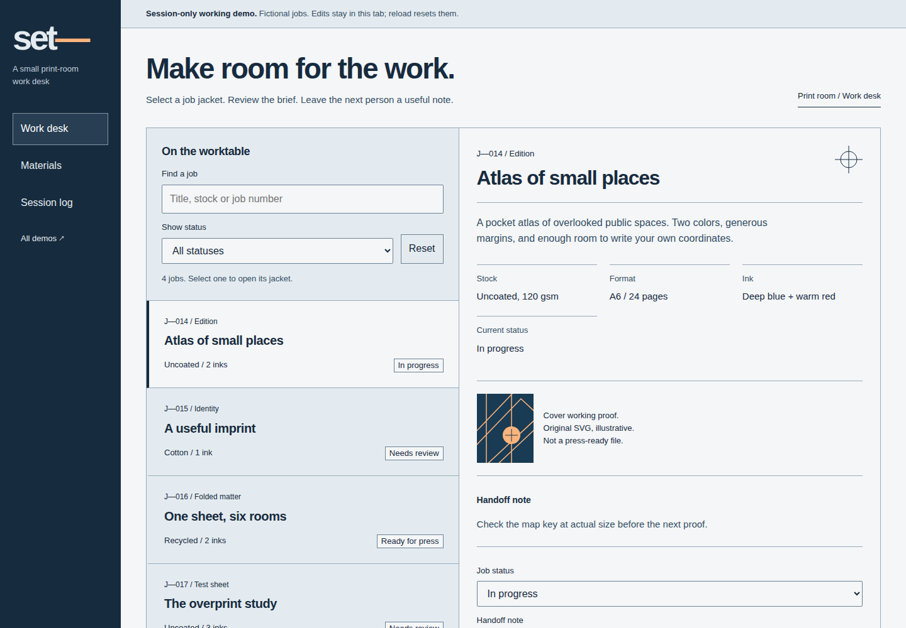

# Read the examples as decisions

Open `index.html` locally. All demonstrations use original local HTML/CSS/SVG and vanilla JavaScript. Content is illustrative; Set's edits are session-only. No network assets, paid models or framework build are needed.

| Example | Premise | Task to exercise | Deliberate tradeoff |
| --- | --- | --- | --- |
| Intertidal | A field journal organizes an argument and its visual evidence | Search a passage, reach its section, clear search and use Back | Reading takes priority over dense controls |
| Set | A print-room job jacket becomes a workbench | Select a job, inspect stock/format/ink, change a note, filter and recover | On narrow layouts the list precedes the jacket; selection moves focus and reaches it |
| Afterimage | An optical artwork gives a fictional cultural program its identity | Filter media, open a work, find visit notes and return | Expression belongs to the poster; program controls remain ordinary |

## Set's modern craft specimen

The source is intentionally readable. The baseline is a complete stacked workbench. An inline-size container query gives the list and inspector separate columns only when their region has room. It responds to an embedded narrow region as well as a small viewport; selection scrolls according to actual geometry. Definition-list metadata uses subgrid when available and independent rows otherwise. Type uses rem units and bounded fluid headings; selected jobs have a structural border marker that survives forced colors.

The signature is the relationship between a physical job jacket, its specifications and the handoff note. No transition is required to use it. The only added motion is a short pointer highlight, enabled when reduced motion is not requested. The palette remains opaque sRGB so this example does not imply modern-color normalization by the contrast tool.

Test the fallback by removing `@container` and `@supports` blocks from the page's CSS in developer tools. The list, metadata, edit action and return route must remain usable. Disabling JavaScript leaves all four jackets readable and explains unavailable edits.

## Evidence to inspect

[Narrow initial view](../docs/assets/workspace-narrow.png) · [Verification and limits](../docs/verification.md)

The interactive tests cover initial and engaged views, links/history, filtering and literal note input. Added Set checks exercise 320/390/768/1440 widths, 200% root text size, an embedded 540px container, RTL geometry, forced colors, keyboard focus and disabled enhancements. RTL geometry is not a translated-content review; enlarged root text is not a full browser-zoom or assistive-technology audit. Screenshots and task checks are evidence for these examples, not a benchmark of generated design quality.
